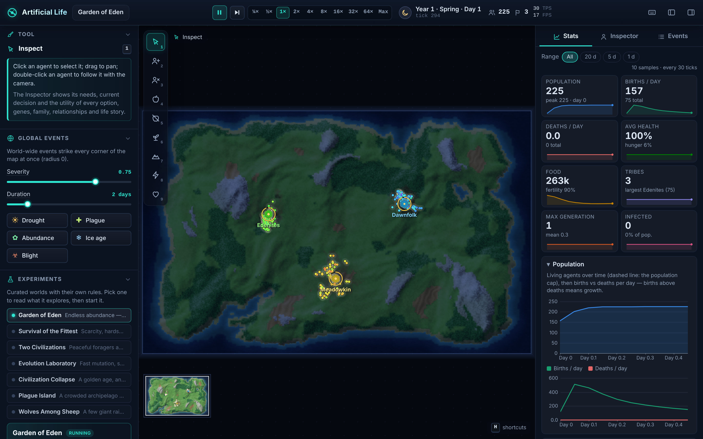

# Artificial Life

**An offline, deterministic civilization simulator in the browser.** Hundreds of agents forage, rest, fight, share, mate and form tribes on a procedurally generated island. Every behavior comes from needs, genes and local rules, not scripts. Natural selection shifts the gene pool over generations. You can step in at any moment with food, terrain, disasters and new populations.

- **Play online:** <https://rahv-fb.github.io/AL/>
- **Offline:** download `dist/index.html` (one self-contained file, no server and no network) and open it in any modern browser.
- TypeScript, Vite and Canvas 2D. No runtime dependencies.


<!-- regenerate with: npm run build && node scripts/browser-smoke.mjs -->

---

## Quick start

| Goal | Command |
| --- | --- |
| Open the built app | open `dist/index.html` directly (file:// works) |
| Install dependencies | `npm install` (Node 22 recommended) |
| Run the dev server (hot reload) | `npm run dev` and open the printed URL |
| Run all tests | `npm test` |
| Typecheck | `npm run typecheck` |
| Production build (single file) | `npm run build` → `dist/index.html` |
| Preview the production build | `npm run preview` |
| Simulation benchmark | `npm run bench` |
| Browser smoke test and screenshot | `npm run build && node scripts/browser-smoke.mjs` |

## Controls

| Input | Action |
| --- | --- |
| `Space` | Pause / resume |
| `.` | Advance a single tick (while paused) |
| `1`–`9` | Select a tool:<br>`1` Inspect · `2` Spawn agents · `3` Remove agents · `4` Add food · `5` Remove food · `6` Fertilize · `7` Paint terrain · `8` Disaster · `9` Bless/Smite (Shift-click to smite) |
| `W` `A` `S` `D` / arrow keys | Pan the camera (you can also drag with Inspect or Bless) |
| Mouse wheel | Zoom (toward the cursor) |
| Click | With Inspect, select an agent and open the inspector (mind, genes, family, relationships)<br>Double-click to follow the agent |
| `F` | Follow the selected agent |
| `Esc` | Deselect / cancel the current tool |
| `H` | Show or hide the help overlay |

The toolbar also has speed controls and map overlays (food, fertility, population density, tribe territory, disease, climate). Every runtime parameter has a slider with an explanation: mutation rate and size, reproduction, plant regrowth, food capacity, harshness, disaster rate, disease virulence, aggression and cooperation bias, mate compatibility and the population cap. These are defined in `src/sim/config.ts → PARAM_SPECS`.

## Experiment presets

Each preset is a declarative `ScenarioDef` in `src/sim/presets.ts`. It sets the config, world-generation knobs, starting populations (with chosen gene templates and tribes) and scheduled events, plus a "what to look for" list that the UI shows.

| Preset | Idea | Watch for |
| --- | --- | --- |
| **Garden of Eden** (`eden`) | Abundant food, gentle genomes, three friendly tribes, no random disasters | Near-exponential growth up to the population cap; tribes splitting as they grow |
| **Survival of the Fittest** (`fittest`) | Scarce food, harsh metabolism, high aggression bias, very diverse genomes | Early starvation crash, then survivors with shifted traits (speed rises); frequent fights |
| **Two Civilizations** (`two-civs`) | River-divided island: peaceful foragers (west) vs. warlike raiders (east) | Territory borders forming at the fords, wars, raids and which strategy outlasts the other |
| **Evolution Laboratory** (`evolab`) | High mutation, strict mate compatibility, recurring regional droughts / cold snaps / blooms | Gene-distribution heatmaps drifting under shifting pressure; reproductive isolation |
| **Civilization Collapse** (`collapse`) | Lush world, one big tribe, overgrazing on; scheduled drought + blight (day 8) and cold snap (day 10) | Overshoot, soil degradation (fertility overlay), starvation collapse, possible recovery |
| **Plague Island** (`plague-island`) | Crowded sociable archipelago, epidemic on day 3 | SIR epidemic waves, immunity and virulence evolving, sociable clusters hit hardest |
| **Wolves Among Sheep** (`predators`) | A small band of giant aggressive raiders among many peaceful foragers | Predation once food tightens, fleeing herds, raiders' fate when prey thins out |

## How the simulation works

### Agents and needs
Each agent has a **stomach** (hunger = 1 − food/maxFood), **health**, **energy** (stamina, restored by resting) and food it **carries** for sharing or depositing. A utility-AI brain re-scores 14 actions every few ticks and picks the best one: *idle, wander, explore, forage, eat, rest, flee, attack, share, mate, socialize, go home, deposit, withdraw*. The inspector shows the scores and a plain-language "thought". Agents also have:

- short **memories** of rich food spots and dangerous places
- **skills** (forage, combat, social) that improve with practice
- a **role** (forager, warrior, caretaker or explorer)
- a capped personal life log

Agents die of **starvation, old age, combat, disease, disasters** or removal by the user.

### Genes and trade-offs
There are 12 genes, each in [0, 1]. They are expressed as traits in `genetics.expressTraits`. **No gene is free.** Every benefit either costs food each tick or has a built-in drawback, so a gene only spreads where the environment rewards it.

| Gene | Benefit | Cost |
| --- | --- | --- |
| speed | reach food, escape | muscle upkeep; movement cost ∝ v²·size; tires |
| size | health, stomach, strength, cold resistance | higher basal burn and movement cost; matures later |
| perception | sees food and danger from afar | small neural upkeep |
| metabolism | faster healing and stamina recovery, body heat | multiplies all upkeep (0.6–1.5×) |
| fertility | breeds sooner, shorter cooldown | each child starts with less food (r- vs K-strategy) |
| longevity | longer life | repair upkeep every tick |
| immunity | resists disease | immune upkeep every tick |
| efficiency | more food per bite | digestive upkeep |
| aggression · sociability · altruism | fighting/stealing · company and tribe affinity · sharing/helping | behavioral costs: injuries, food given away, crowding |
| hue | none (neutral marker) | drifts by mutation, so lineages show up as colors |

**Reproduction:**

- Two compatible adults produce a child by crossover with mild gene linkage, then Gaussian mutation (`mutationRate`, `mutationSize`).
- Mates must be within `mateCompatibility` genetic distance (mean absolute gene difference, hue included). A low value causes reproductive isolation and **speciation**.
- Generations and family trees are tracked in a capped lineage registry.

### Social life and tribes
- **Relationships:** each agent keeps up to 12. Each has an affinity from −1 (enemy) to +1 (close friend) and a kinship flag (parent/child or sibling). They grow through socializing, sharing and fights.
- **Behavior biases:** the genes plus global biases (`aggressionBias`, `cooperationBias`) set the likelihood of fighting, stealing or sharing.
- **Tribes:** each tribe has a **camp** with a shared **stockpile** that members deposit to and withdraw from. Tribes also track **territory** (tiles controlled), **roles**, mean genes and **relations** with other tribes, from −1 (war) to +1 (alliance). Tribes can split (fission), and they go extinct when their last member dies.

### Ecology, seasons and weather
- **Terrain:** there are 8 terrain types, each with its own food capacity, regrowth rate and movement cost:
  - deep water: impassable
  - shallows
  - sand
  - grassland
  - forest: rich but slow
  - desert
  - mountain: a slow refuge
  - player-built wall: impassable
- **Food:** grows on tiles. Regrowth scales with terrain × soil fertility × season × active disasters × `foodRegen`. With `overgrazing` on, stripping a tile bare degrades its fertility, which slowly recovers toward its natural level.
- **Day and night:** a day lasts `dayLength` ticks (default 600), and a season lasts `daysPerSeason` days (default 3). The default year is therefore 12 days = 7,200 ticks.
- **Seasons:** spring, summer, autumn and winter change temperature and plant growth. Cold raises metabolic cost; size and metabolism help resist it.

### Disasters and disease
- Six disasters, triggered randomly (`disasterRate`) or by the user:
  - **drought:** regrowth collapses
  - **blight:** food and soil fertility are destroyed
  - **abundance:** a food bloom
  - **plague:** infects agents
  - **meteor:** kills at the impact point and scorches the land
  - **cold snap:** the temperature plunges
- **Disease** spreads between nearby agents. Infected agents carry a virulence and lose health. Survivors gain temporary immunity, and the immunity gene lowers the risk. `diseaseVirulence` scales contagion and lethality.

> Exact coefficients live in the module headers and exported tuning objects (`VITALS`/`REPRO` in lifecycle/genetics, `SOCIAL_TUNING`, `DISEASE`, `DISASTER_TUNING`, `REGROWTH_RATE`/`SEASON_GROWTH` in ecology).

## Architecture

```
src/
  sim/      pure, deterministic simulation core (no DOM). Runs headless in Node for tests.
    types.ts        shared contracts (SimState is plain JSON-serializable data)
    simulation.ts   orchestrator: tick loop, indexes, births/deaths, events, hash()
    rng.ts          seeded sfc32 PRNG; its state is saved in SimState (Math.random is never used)
    world.ts ecology.ts brain.ts lifecycle.ts genetics.ts social.ts disease.ts
    disasters.ts interventions.ts stats.ts presets.ts persistence.ts spatial.ts
  render/   Canvas 2D renderer: camera, cached terrain layer, colors, agents, overlays
  ui/       app shell, toolbar, inspector, analytics charts, event log
tests/      vitest (node): smoke, determinism, invariants, long-run, perf, balance report
scripts/    QA helpers + Playwright browser smoke test
```

**Tick order** (`simulation.ts`, fixed for determinism):

1. scheduled scenario events, then replayed interventions, then queued user interventions
2. environment clock (day/night, seasons, temperature)
3. disasters
4. plant regrowth and fertility
5. spatial-hash rebuild
6. each agent in array order: *think* (when its cooldown expires) → *act* → *update vitals*
7. disease
8. social systems (tribes, relationships, territory, roles)
9. flush deaths (compaction) and births (append)
10. statistics sampling
11. `tick++`

Derived indexes (`agentById`, `tribeById`, `lineageById` and the spatial hash) live on the `Simulation` object, not in `SimState`. They are rebuilt on load. All long-lived arrays are capped (`LIMITS` in `src/sim/constants.ts`): events, lineage, stat samples, tribes, the intervention log, and each agent's relationships, children, history and memories.

## Determinism, replays and save files

- **Same seed + same interventions at the same ticks ⇒ the same simulation.** `Simulation.hash()` fingerprints the state, and `tests/determinism.test.ts` checks it at several checkpoints.
- **Every user intervention is recorded** with its tick in `state.interventionLog`. **Restart & replay** recreates the run from the scenario and seed and re-applies the log.
- **Save files** are JSON snapshots of `SimState`. Typed arrays are base64-encoded, and the file carries a format `version` (`SAVE_VERSION`). Loading validates the file and rebuilds the indexes, and save → load → continue is identical to never saving (covered by `tests/determinism.test.ts` and `tests/persistence.test.ts`).
- **Caveat:** replays are bit-exact within the same build and JS engine. Different browser engines may round `Math.sin`, `Math.exp` and similar functions differently in the last bit, so a replay could drift slightly across browsers.

## Testing and verification

| Test | What it proves |
| --- | --- |
| `tests/smoke.test.ts` | every preset runs 1,500 ticks without throwing or producing NaN |
| `tests/determinism.test.ts` | same seed ⇒ same hashes; different seed ⇒ different; replay of the intervention log; save/load/continue; no `Math.random` |
| `tests/invariants.test.ts` | 3,000 ticks per preset plus an intervention barrage. Checks run every 25 ticks: finite numbers, vitals in range, passable positions, unique ids, consistent indexes and tribe references, pruned relationships, world food and fertility ranges, the population cap and log caps. |
| `tests/longrun.test.ts` | 20,000 ticks on two presets: bounded population, state arrays and retained heap |
| `tests/perf.bench.test.ts` | about 1,000 agents for 500 ticks; prints mean/p50/p95 ms per tick and asserts a generous budget |
| `tests/balance.report.test.ts` | informational: a per-day table per preset (population, births, deaths by cause, tribes, generation, hunger, food, gene means) |
| `scripts/browser-smoke.mjs` | loads `dist/index.html` in headless Chromium; fails on console or page errors or a blank canvas; clicks controls; saves `docs/screenshot.png` |

Vitest hides the output of passing tests in non-interactive terminals. Add `--silent=false` to see the reports:

```bash
npx vitest run tests/balance.report.test.ts --silent=false                 # balancing table
AL_BALANCE_DAYS=20 AL_BALANCE_SCENARIO=eden AL_SEED=7 npx vitest run tests/balance.report.test.ts --silent=false
npm run bench -- --silent=false                                            # perf numbers
AL_LONGRUN_TICKS=5000 npx vitest run tests/longrun.test.ts --silent=false  # quicker long run
```

Environment knobs: `AL_INVARIANT_TICKS`, `AL_LONGRUN_TICKS`, `AL_LONGRUN_HEAP_MB`, `AL_PERF_BUDGET_MS`, `AL_BALANCE_DAYS`, `AL_BALANCE_SCENARIO` and `AL_SEED`. The browser smoke test needs Playwright with Chromium (`npm i -D playwright && npx playwright install chromium`). It accepts `--url <url>`, `--wait <ms>`, `--out <png>` and `--no-screenshot`. Recorded results are in [`docs/VERIFICATION.md`](docs/VERIFICATION.md).

**CI and deployment:**

- `.github/workflows/ci.yml` runs typecheck, tests and the build on every pull request.
- `.github/workflows/pages.yml` tests, builds and deploys `dist/` to GitHub Pages on every push to `main`. In the repository settings, set Pages → Source to **GitHub Actions**.

## Limitations

- **Population cap:** default 1,000 living agents, adjustable from 50 to 2,000. The simulation is single-threaded and grid-based (2D, tile size 8 world units), so the cap keeps the frame rate up.
- **Decision-making:** agents use hand-tuned utility functions over their needs and genes. There is no learning neural network, and "culture" is limited to relationships, tribes, roles and practiced skills.
- **Analytics:** statistics are sampled periodically and downsampled over long runs. The lineage registry keeps the most recent ancestors (6,000), so very deep family trees are truncated.
- **Save files:** they are tied to the save-format version. A file from an incompatible version is rejected with a readable error.
- **Cross-browser replays:** see the determinism caveat above.
