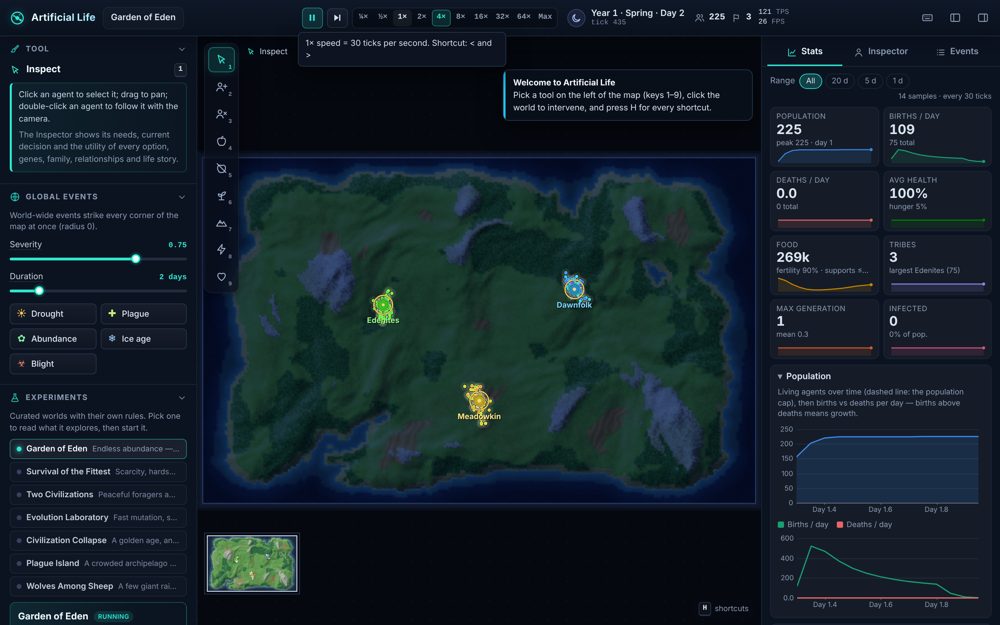

# Artificial Life

**An offline, deterministic civilization simulator in the browser.** Hundreds of agents forage, rest, fight, share, mate and form tribes on a procedurally generated island. Their behavior comes from needs, genes and local rules, not scripts, and natural selection shifts the gene pool over generations. You can step in at any time with food, terrain, disasters and new populations.

- **Play online:** <https://rahv-fb.github.io/AL/>, deployed from this repository by `.github/workflows/pages.yml`. As of 2026-11-18 no deployment has succeeded yet (see [CI and deployment](#testing-and-verification)), so the link may not load. Use the offline file instead.
- **Play offline:** download [`release/artificial-life.html`](release/artificial-life.html) and open it in any modern browser. It is one self-contained file: no server, no install and no network access.
- **Stack:** TypeScript, Vite and Canvas 2D, with no runtime dependencies. The app makes no network requests and sends no telemetry. The only thing it stores is UI preferences (view toggles, overlay, open panels), in `localStorage`.
- **Docs:** requirement coverage is in [`docs/REQUIREMENTS.md`](docs/REQUIREMENTS.md) and measured results are in [`docs/VERIFICATION.md`](docs/VERIFICATION.md).


<!-- regenerate with: npm run build && node scripts/browser-smoke.mjs -->

---

## Quick start

| Goal | Command |
| --- | --- |
| Run the app without building | Open `release/artificial-life.html` directly (`file://` works) |
| Install dependencies | `npm install` (Node 22, the version CI uses) |
| Dev server with hot reload | `npm run dev`, then open the printed URL |
| Typecheck | `npm run typecheck` |
| Run all tests (several minutes; includes the long-run, perf and balance tests) | `npm test` |
| Production build (single file) | `npm run build` → `dist/index.html` |
| Update the committed offline file | `npm run build && cp dist/index.html release/artificial-life.html` |
| Preview the production build | `npm run preview` |
| Simulation benchmark | `npm run bench` |
| Balance report (a per-day table for each preset) | `npm run balance` |
| Browser smoke test and screenshot | `npm run build && npm run smoke:browser` |

## Controls

The app opens on **Garden of Eden**, running at 1× (30 ticks per second). Hover over any control to see what it does, or press `H` for the shortcut sheet.

**Keyboard**

| Key | Action |
| --- | --- |
| `Space` | Pause / resume |
| `.` | Advance one tick (pauses first if the simulation is running) |
| `<` `>` | Slower / faster (¼× … 64×, then Max) |
| `1`–`9` | Choose a tool (see below) |
| `W` `A` `S` `D` / arrow keys | Pan the camera |
| `+` `-` | Zoom in / out |
| `0` | Fit the whole world on screen |
| `F` | Follow the selected agent (press again to stop) |
| `[` `]` | Shrink / grow the brush |
| `O` / `Shift`+`O` | Next / previous data overlay |
| `Esc` | Deselect the agent, stop following and switch back to Inspect (also closes the help sheet) |
| `H` or `?` | Open the help sheet with every shortcut |
| `Ctrl`+`S` / `Ctrl`+`O` (`⌘` on macOS) | Save / load the experiment |

**Mouse**

| Input | Action |
| --- | --- |
| Wheel | Zoom toward the cursor (`Alt`+wheel resizes the brush) |
| Left-drag | With Inspect, Spawn, Disaster or Bless: pan. With the painting tools (Remove agents, Add food, Remove food, Fertilize, Paint terrain): paint |
| Right-drag or middle-drag | Pan, with any tool |
| Click (Inspect) | Select an agent and open the inspector |
| Double-click (Inspect) | Select an agent and follow it with the camera |
| Click (Bless / Smite) | Fully heal, feed and rest an agent |
| `Shift`+click (Bless / Smite) | Kill an agent |
| Minimap | Click or drag to move the camera |
| Drop a `.json` save on the window | Load it |

**Tools** sit on the rail at the left edge of the map, on keys `1`–`9`:

`1` Inspect · `2` Spawn agents · `3` Remove agents · `4` Add food · `5` Remove food · `6` Fertilize · `7` Paint terrain · `8` Disaster · `9` Bless / Smite

- Spawn, Disaster and the painting tools draw a circle that shows where they act.
- Remove agents, Add food, Remove food and Fertilize keep acting while you hold the button still.
- Paint terrain can also lay impassable walls and deep water.
- While the simulation is paused, each edit advances it by one tick so you can see the result.

**Panels**

- **Top bar:** play/pause, single step and speed (¼× to 64×, and Max), plus the calendar, population, tribe count and TPS/FPS. A "CPU-limited" badge appears when the requested speed cannot be reached.
- **Left sidebar:**
  - **Tool:** options for the current tool. For Spawn, the population designer sets group size, gene means and spread, archetypes and tribe.
  - **Global events:** world-wide Drought, Plague, Abundance, Ice age (a cold snap) and Blight, with severity and duration.
  - **Experiments:** the presets and a seed box, with three buttons. **Restart** uses the seed in the box and does not re-apply your interventions. **New seed** restarts with a random seed. **Replay my interventions** restarts and re-applies them.
  - **View:** data overlays (food, fertility, density, territory, disease, climate) and toggles for vision radius, trails, relationships, tribe camps, name labels, minimap and overlay legend, plus Fit world and Follow selected buttons.
  - **Parameters:** 12 sliders defined in `src/sim/config.ts` → `PARAM_SPECS`: mutation rate, mutation size, reproduction rate, plant regrowth, food capacity, environmental harshness, random disasters, disease virulence, aggression bias, cooperation bias, mate compatibility and population cap. Below them are toggles for overgrazing, seasons, day/night and tribes. Each change is recorded as an intervention, so it replays deterministically.
  - **Save & load.**
- **Right sidebar:**
  - **Stats:** live figures and charts for population, births and deaths per day, vitals, resources, tribes, deaths by cause, gene distributions over time, actions and roles. The range can be All, 20 d, 5 d or 1 d.
  - **Inspector:** needs, decision scores, genes, skills, relationships, family tree and life story, with buttons to follow, bless or smite the agent.
  - **Events:** a filterable chronicle. Click an event to jump to where it happened.

## Experiment presets

Each preset is a declarative `ScenarioDef` in `src/sim/presets.ts`. It sets the config, world-generation options, the starting populations (gene templates and tribes) and scheduled events. It also has a "what to look for" list, which the Experiments panel shows.

| Preset | Setup | What it explores |
| --- | --- | --- |
| **Garden of Eden** (`eden`) | Twice the plant regrowth, 1.5× food capacity, cheap metabolism and no random disasters. Three gentle tribes. A bloom on day 4 | Growth with selection relaxed: how fast the bands fill the island, what finally limits them, and what happens when their territories meet |
| **Survival of the Fittest** (`fittest`) | Scarce food, wide deserts, 1.6× harshness, 1.5× aggression and a raised mutation rate. Four groups of very diverse loners. Drought on day 3, frost on day 7, plague on day 10 | Selection under pressure. A short boom ends in a starvation crash, and the survivors are faster (the mean speed gene rises). Do loners still band together into tribes? |
| **Two Civilizations** (`two-civs`) | A river with a few fords splits the island. Peaceful, efficient foragers live in the west and big, aggressive raiders in the east. A western harvest on day 5 and an eastern drought on day 9 | Whether cooperation or aggression wins territory and food, with borders, raids and wars at the fords |
| **Evolution Laboratory** (`evolab`) | About 3× the mutation rate, strict mate compatibility (0.2) and a mountain range with passes. Four groups of loners. Every 2 days a drought, cold snap or bloom hits the next quadrant | Local adaptation and speciation: hue clusters separating by region, and gene histograms with two peaks |
| **Civilization Collapse** (`collapse`) | A lush world with one big, fast-breeding tribe, overgrazing on and a cap of 1,400. Global drought plus a heartland blight on day 8, a global cold snap on day 10, and rain returning only in the north-east on day 14 | Overshoot, soil degradation (fertility overlay), starvation collapse and possible recovery |
| **Plague Island** (`plague-island`) | An archipelago with five crowded, sociable tribes whose immunity is weak. 1.5× disease virulence. Plague on day 3, and a second strain on day 10 | Epidemic waves, water acting as quarantine, and immunity and virulence evolving |
| **Wolves Among Sheep** (`predators`) | About 200 small, peaceful foragers and 12 giant, aggressive raiders who gather plants poorly. A second pack arrives on day 6 | Predator–prey dynamics: raids once food runs short, and prey fleeing or banding together |

## How the simulation works

### Agents and needs
Each agent has:
- a **stomach** (hunger = 1 − food/maxFood)
- **health**
- **energy** (stamina, restored by resting)
- food it **carries**, for sharing or for depositing at camp

Every few ticks, and sooner when threatened, a utility-AI brain scores 14 actions and picks the best one: *idle, wander, explore, forage, eat, rest, flee, attack, share, mate, socialize, go home, deposit, withdraw*. The inspector shows the scores and a plain-language "thought". Agents also have:

- short **memories** of rich food spots (4) and dangerous places (3)
- **skills** (forage, combat, social) that improve with practice
- an emergent **role** (forager, warrior, caretaker or explorer), chosen by comparative advantage
- a capped personal life log

Agents die of **starvation, old age, combat, disease, disasters**, or **removal** by you.

### Genes and trade-offs
There are 12 genes, each in [0, 1]. `genetics.expressTraits` turns them into traits. **No gene is free.** Every benefit either costs food every tick or has a built-in drawback, so a gene spreads only where the environment rewards it.

| Gene | Benefit | Cost |
| --- | --- | --- |
| speed | reach food, escape | muscle upkeep; movement cost ∝ v²·size; tires |
| size | health, stomach, strength, cold resistance | higher basal burn and movement cost; matures later |
| perception | sees food and danger from afar | small neural upkeep |
| metabolism | faster healing and stamina recovery, body heat | multiplies all upkeep (0.6–1.5×) |
| fertility | breeds on an emptier stomach, shorter cooldown | each child starts with less food (r- vs K-strategy) |
| longevity | longer life | repair upkeep every tick |
| immunity | resists disease | immune upkeep every tick |
| efficiency | more food per bite | digestive upkeep |
| aggression · sociability · altruism | fighting and stealing · company and tribe affinity · sharing and helping | behavioral costs: injuries, food given away, crowding |
| hue | none (neutral marker) | drifts by mutation, so lineages show up as colors |

**Reproduction:**

- Two fertile adults produce a child. Its genes come from crossover with mild gene linkage, followed by Gaussian mutation (`mutationRate`, `mutationSize`). Close kin cannot mate.
- Mates must be within `mateCompatibility` of each other in genetic distance (mean absolute gene difference, hue included). A low value causes reproductive isolation and **speciation**.
- A capped lineage registry tracks generations and family trees.

### Social life and tribes
- **Relationships:** each agent keeps up to 12. Each has an affinity, from −1 (enemy) to +1 (close friend), and a kinship flag (parent/child or sibling). Socializing and gifts raise affinity; fights lower it.
- **Behavior biases:** the genes, together with the global `aggressionBias` and `cooperationBias`, set how likely agents are to fight, steal or share. Hungry, aggressive agents hunt others when plants are scarce.
- **Tribes:**
  - Each tribe has a **camp** with a shared **stockpile**. Members deposit food there and withdraw it, and in cold weather the camp halves cold stress for members nearby.
  - Tribes also track **territory** (tiles controlled), **roles**, mean genes and **relations** with other tribes, from −1 (war) to +1 (alliance).
  - Tribes can split (fission), and they go extinct when their last member dies.

### Ecology, seasons and weather
- **Terrain:** there are 8 terrain types, each with its own food capacity, regrowth rate and movement cost:
  - deep water: impassable
  - shallows
  - sand
  - grassland
  - forest: rich but slow
  - desert
  - mountain: a slow refuge
  - wall (built by you): impassable
- **Food:** plant food grows on tiles. Regrowth scales with terrain × soil fertility × season × active disasters × `foodRegen`. With `overgrazing` on, a tile stripped bare loses fertility, which slowly recovers toward its natural level.
- **Day and night:** a day lasts `dayLength` ticks (default 600), and a season lasts `daysPerSeason` days (default 3). The default year is therefore 12 days, or 7,200 ticks. Night shortens vision, and agents tend to sleep.
- **Seasons:** spring, summer, autumn and winter change temperature and plant growth. Cold raises metabolic cost; size and metabolism help resist it.

### Disasters and disease
- **Disasters:** there are six. They happen at random (`disasterRate`), on a preset's schedule, or when you trigger them:
  - **drought:** regrowth collapses
  - **blight:** food and soil fertility are destroyed
  - **abundance:** food blooms
  - **plague:** agents are infected
  - **meteor:** agents at the impact point die and the land is scorched
  - **cold snap:** the temperature plunges
- **Disease** spreads between nearby agents:
  - Each infection has a virulence that mutates as it spreads, and infected agents lose health.
  - Survivors gain temporary immunity, and the immunity gene lowers the risk.
  - `diseaseVirulence` scales both how contagious and how lethal disease is.

> Exact coefficients live in the module headers and the exported tuning objects: `VITALS` (lifecycle), `UPKEEP` and `REPRO` (genetics), `SOCIAL_TUNING`, `DISEASE`, `DISASTER_TUNING`, and `REGROWTH_RATE`/`SEASON_GROWTH` (ecology).

## Architecture

```
src/
  main.ts          entry point: mounts the App (shows an error card if startup fails)
  sim/             deterministic simulation core: no DOM, runs headless in Node
    types.ts         shared contracts (SimState is plain data; typed arrays are base64-encoded on save)
    simulation.ts    orchestrator: tick loop, intervention queue and log, births/deaths, indexes, events, hash()
    rng.ts           seeded sfc32 PRNG; its state is saved in SimState (Math.random is never used)
    config.ts        DEFAULT_CONFIG and PARAM_SPECS (slider ranges and help text)
    constants.ts     terrain rules, SAVE_VERSION, LIMITS
    world.ts         procedural island generation and passable-tile search
    ecology.ts       clock, seasons, temperature, plant regrowth, soil fertility
    brain.ts         utility AI (think/act); steering.ts handles terrain-aware movement
    lifecycle.ts     vitals, growth, aging and death
    genetics.ts      genes → traits, upkeep, crossover, mutation, mating
    social.ts        relationships, combat, sharing, stockpiles, tribes, territory, roles
    disasters.ts     droughts, blights, blooms, plagues, meteors, cold snaps
    disease.ts       infection, transmission, recovery and immunity
    interventions.ts every user or scenario action: validated, logged, explained
    stats.ts         sampled statistics and milestone events
    presets.ts       the seven experiments
    persistence.ts   save files: serialize, validate, repair
    spatial.ts       uniform-grid spatial hash; names.ts generates names
  render/          Canvas 2D: camera, cached terrain and vegetation layer, overlays, agents, disaster effects, minimap
  ui/              app shell and frame loop, toolbar and sidebars, tools, population designer, charts, inspector, event log
tests/             vitest (node): a unit test per module plus smoke, determinism, invariants, long-run, perf, balance and spec tests
scripts/           QA helpers and the Playwright browser smoke test
release/           committed single-file build (artificial-life.html)
docs/              REQUIREMENTS.md, VERIFICATION.md, screenshot.png
```

**Tick order** (`simulation.ts`, fixed for determinism):

1. scheduled scenario events, then replayed interventions, then queued user interventions
2. environment clock (day/night, seasons, temperature)
3. disasters
4. plant regrowth and fertility
5. spatial-hash rebuild
6. each agent in array order: *think* (when its cooldown expires) → *act* → *update vitals*
7. disease
8. social systems (tribes, relationships, territory, roles)
9. flush deaths (compaction) and births (append)
10. statistics sampling
11. `tick++`

The UI changes the world only through `sim.enqueue(intervention)`. The intervention is applied, and recorded with its tick, at the start of the next tick.

Derived indexes (`agentById`, `tribeById`, `lineageById` and the spatial hash) live on the `Simulation` object, not in `SimState`, and are rebuilt on load. All long-lived arrays are capped by `LIMITS` in `src/sim/constants.ts`: events, lineage, stat samples, tribes, the intervention log, and each agent's relationships, children, history and memories.

## Determinism, replays and save files

- **Same seed + same interventions at the same ticks ⇒ the same simulation.** `Simulation.hash()` fingerprints the state, and `tests/determinism.test.ts` checks it at several checkpoints.
- **Your interventions are recorded** with their ticks in `state.interventionLog`, including parameter changes. **Replay my interventions** recreates the run from the scenario and seed, then re-applies the log at the original ticks.
- **Save files** are JSON snapshots of `SimState`, tagged with `"format": "artificial-life-save"` and a `version` (`SAVE_VERSION`). Typed arrays are base64-encoded, and NaN and ±Infinity are tagged.
- **Loading** treats the file as untrusted. It enforces a size limit and checks the format and version, then validates every field. Damaged values are repaired, and unusable files are rejected with a readable message. The loader lists each repair (`deserializeState(json, { warnings })`) and the app shows them in a warning toast (full list in the browser console), so a damaged file never loads silently.
- **Save → load → continue** gives the same simulation as never saving: agents, tribes and the world evolve identically. This is covered by `tests/determinism.test.ts` and `tests/persistence.test.ts`. Some event-log messages can still differ after a load, because the bookkeeping behind them is not saved. Examples are an epidemic's final death and peak counts, and some alliance announcements.
- **Caveat:** replays are bit-exact within the same build and JavaScript engine. World generation uses only IEEE-exact arithmetic, but the simulation calls `Math.sin`, `Math.exp` and similar functions, which may round differently in the last bit on another engine. A replay can therefore drift slightly across browsers.

## Testing and verification

| Test | What it proves |
| --- | --- |
| `tests/<module>.test.ts` | unit tests for brain, genetics, lifecycle, ecology, social, disease, disasters, world, interventions, stats, persistence and presets |
| `tests/smoke.test.ts` | every preset runs 1,500 ticks without throwing or producing NaN |
| `tests/determinism.test.ts` | same seed ⇒ same hashes; different seed ⇒ different hashes; the intervention log replays; save/load/continue matches; no `Math.random` |
| `tests/invariants.test.ts` | 3,000 ticks per preset plus an intervention barrage, checked every 25 ticks: finite numbers, vitals in range, passable positions, unique ids, consistent indexes and tribe references, pruned relationships, world food and fertility ranges, the population cap and the log caps |
| `tests/longrun.test.ts` | 20,000 ticks on two presets: population, state arrays and retained heap all stay bounded |
| `tests/perf.bench.test.ts` | about 1,000 agents for 500 ticks; prints mean/p50/p95 ms per tick and checks a generous budget |
| `tests/balance.report.test.ts` | informational: a per-day table for each preset (population, births, deaths by cause, tribes, generation, hunger, food, gene means) |
| `tests/spec-requirements.test.ts` | the required features and presets exist, every intervention is explained, the offline build is self-contained, selection visibly shifts a gene, and this README matches the code |
| `tests/spec-docs-drift.test.ts` | what this README says about loading save files (repairs are made, listed and shown to the user) still matches the code |
| `scripts/browser-smoke.mjs` | loads `dist/index.html` (or `--url`) in headless Chromium and fails on console or page errors, failed requests or a blank canvas; toggles play/pause, presses a few shortcuts and saves `docs/screenshot.png` |

Vitest hides the console output of passing tests. Add `--silent=false` to see the reports:

```bash
npx vitest run tests/balance.report.test.ts --silent=false                 # balancing table
AL_BALANCE_DAYS=20 AL_BALANCE_SCENARIO=eden AL_SEED=7 npx vitest run tests/balance.report.test.ts --silent=false
npm run bench                                                              # perf numbers (already --silent=false)
AL_LONGRUN_TICKS=5000 npx vitest run tests/longrun.test.ts --silent=false  # quicker long run
```

- **Environment knobs:** `AL_INVARIANT_TICKS`, `AL_LONGRUN_TICKS`, `AL_LONGRUN_HEAP_MB`, `AL_PERF_BUDGET_MS`, `AL_BALANCE_DAYS`, `AL_BALANCE_SCENARIO` and `AL_SEED`.
- **Browser smoke test:** it needs Playwright with Chromium (`npm i -D playwright && npx playwright install chromium`). It accepts `--url <url>`, `--wait <ms>`, `--out <png>` and `--no-screenshot`.
- **Recorded results:** see [`docs/VERIFICATION.md`](docs/VERIFICATION.md).

**CI and deployment:**

- `.github/workflows/ci.yml` runs the typecheck, the full test suite and the build on every push and pull request, then uploads `dist/index.html` as a build artifact.
- `.github/workflows/pages.yml` typechecks, builds and deploys `dist/` to GitHub Pages on pushes to `main` and to the `claude/artificial-life-simulator-8iuk86` branch, or when started manually. It does not run the tests.
- **Deployment status:** every Pages run so far has built successfully but failed in the `deploy` job, which never got a runner. To fix it, open the repository settings:
  1. Set Pages → Source to **GitHub Actions**.
  2. Under Environments → `github-pages`, allow the branch you deploy from.

## Limitations

- **Population cap:** the default is 1,000 living agents, adjustable from 50 to 2,000. The simulation is single-threaded and grid-based (2D, with tiles 8 world units wide), so the cap keeps the frame rate up.
- **Decision-making:** agents use hand-tuned utility functions over their needs and genes. There is no learning neural network, and "culture" is limited to relationships, tribes, roles and practiced skills.
- **Economy:** plant food is the only resource. Exchange means gifts between agents and a shared tribe stockpile; there is no trade between different goods.
- **Analytics:** statistics are sampled every 30 ticks, and old history is merged to save space during long runs. The lineage registry holds at most 6,000 records. When it is full, the oldest dead ancestors are dropped first, so very deep family trees are cut short.
- **Replay length:** the intervention log keeps only the latest 5,000 interventions. Drag-painting records a stamp about every 40 ms, so after a long editing session the earliest interventions are dropped and **Replay my interventions** is no longer exact.
- **Saving during a replay:** a save made while a replay is still re-applying interventions does not include the ones not yet reached. Let the replay pass your last recorded intervention before saving.
- **Save files:** a file from a newer save-format version is rejected with a readable error.
- **Cross-browser replays:** see the determinism caveat above.
